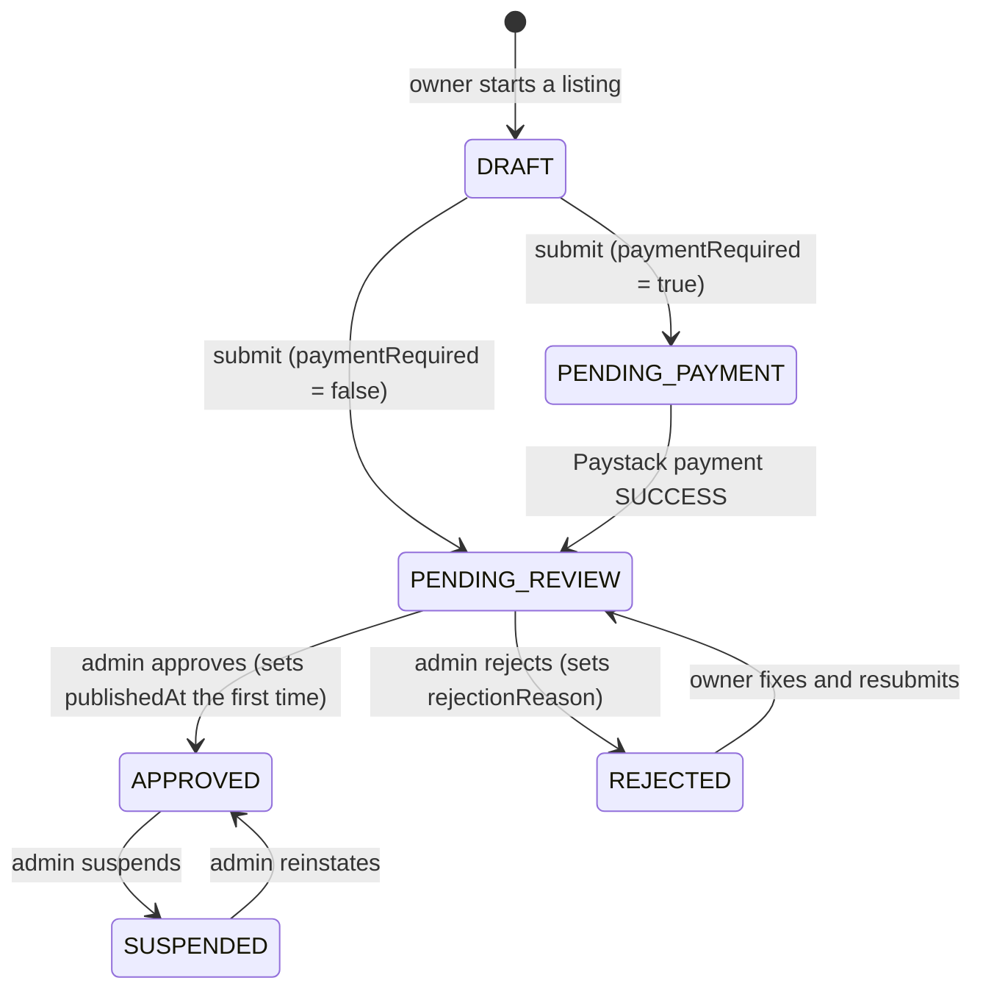

# CustomerHowFar data model

The schema lives in [`prisma/schema.prisma`](../prisma/schema.prisma). PostgreSQL on Supabase,
accessed only through Prisma on the server. Every table has Row Level Security enabled with no
policies, so the public Supabase Data API cannot read or write anything.

## Conventions

- **Tables and columns** are `snake_case` (mapped with `@map`); Prisma models are `PascalCase`.
- **IDs**: UUIDv7 (time-ordered, index-friendly) for user-generated rows; integers for the small
  reference tables (`states`, `lgas`); bigint for high-volume analytics (`contact_events`).
- **Money** is stored in **kobo** as integers (`amountKobo`), never floats. ₦5,000 = 500000.
- **Phone numbers** are stored in E.164 form: `+234XXXXXXXXXX`.
- **Images** are stored as Cloudinary public IDs, never URLs. Build URLs with
  `src/lib/images.ts`.
- **Timestamps**: every mutable table has `created_at` and `updated_at`.
- **Integrity rules the schema language can't express** live as `CHECK` constraints in the
  migration: rating 1–5, positive payment amounts, non-negative counters, etc.

## Models

| Model                  | Purpose                                                                                                                                                                                                                                                                                                                 |
| ---------------------- | ----------------------------------------------------------------------------------------------------------------------------------------------------------------------------------------------------------------------------------------------------------------------------------------------------------------------- |
| `AppSetting`           | Single row (id 1) of global admin settings: `paymentRequired` (listing fee on/off) and `listingFeeNaira`.                                                                                                                                                                                                               |
| `Profile`              | App profile for a Supabase Auth user (same UUID). Name, phone, avatar and `role` (`CUSTOMER`, `BUSINESS_OWNER`, `ADMIN`).                                                                                                                                                                                               |
| `Category`             | Service categories (e.g. Electricians). `slug` is permanent. `icon` is a lucide icon name resolved via `src/config/category-icons.ts`. `parentId` allows subcategories. Deactivate (`isActive = false`) instead of deleting.                                                                                            |
| `State`                | The 36 states plus the FCT (37 rows).                                                                                                                                                                                                                                                                                   |
| `Lga`                  | All 774 Local Government Areas, each linked to its state. Slugs are unique _per state_ (Surulere exists in Lagos and Oyo).                                                                                                                                                                                              |
| `Business`             | A listing owned by a `Profile`: name, category, contact details (phone, WhatsApp, email), address, state + LGA, services, opening hours (JSON), social links, logo/cover images, status, verification and featured flags, and denormalized counters (`viewCount`, `contactClickCount`, `ratingAverage`, `reviewCount`). |
| `BusinessPhoto`        | Work photos for a business (Cloudinary public ID, dimensions, caption, order). Max 12 per business, enforced in app code.                                                                                                                                                                                               |
| `Payment`              | Listing-fee payments via Paystack: amount in kobo, unique `reference` (makes webhooks idempotent), status, `paidAt`, raw provider `metadata`.                                                                                                                                                                           |
| `Review`               | A customer's rating (1–5) and comment. One per user per business. `HIDDEN` reviews are kept but not shown.                                                                                                                                                                                                              |
| `SavedBusiness`        | A user's saved/favourite businesses (composite key: user + business).                                                                                                                                                                                                                                                   |
| `ContactEvent`         | One row per WhatsApp/call/email click, for analytics. `userId` is null for signed-out visitors.                                                                                                                                                                                                                         |
| `IdentityVerification` | An owner's ID check: ID type, full name as typed from the ID, private ID/selfie images, consent time, status, reviewer and decision. History is kept; no ID numbers are ever stored.                                                                                                                                    |
| `ModerationDecision`   | Append-only history of admin decisions on a business: `action` (`APPROVED`, `REJECTED`, `SUSPENDED`, `REINSTATED`), `comment`, admin, time. The latest `REJECTED` comment is shown to the owner as "Changes requested". (Named to avoid confusion with customer `Review`s.)                                             |

| `SettingChange` | Audit log of admin changes to `AppSetting`: field, old and new value, admin, time.

### Moderation and payment fairness

- `ModerationDecision.action` also records `RECHECKED` and `FEATURED`/`UNFEATURED`
  (`VERIFIED`/`UNVERIFIED` exist only in old history; the admin Verify toggle was removed), so every admin change to a listing is in its history.
- Admin actions only apply if the listing's status is still what the admin saw (row lock +
  status check), so two admins can't act on the same listing at once.
- `Business.feeRequiredAtSubmit` records whether the listing fee was on when the owner last
  submitted. Approval requires a `SUCCESS` payment only when it is true; listings submitted
  while the fee was off are honored for free even if the fee is switched on later.
- Admin access: `requireAdmin()` (database role) guards every admin page and action. The proxy
  also returns a real 404 for `/admin` unless the login token's `app_metadata.role` is
  `admin` (set by `npm run make-admin`).

### Payments (bank transfer)

- Methods live in `src/lib/payments/methods.ts`; `PaymentProvider` has `MANUAL_TRANSFER` (and
  `PAYSTACK`, reserved). A method is offered only when switched on AND fully configured in
  `AppSetting` (`manualTransferEnabled` + bank name, 10-digit account number, account name).
  Settings refuse to save "fee on" without an available method.
- Flow: owner starts a transfer → `Payment` `PENDING` with a reference like `CHF-7K3P9Q` and the
  fee in kobo → uploads a proof → `AWAITING_CONFIRMATION` (at most one per business, enforced by
  a partial unique index) → admin confirms (`SUCCESS`) or rejects (`FAILED` + `rejectionReason`).
  Owners can withdraw an unreviewed proof (back to `PENDING`, same reference).
- Proof files are private Cloudinary assets (`type: authenticated`) under
  `customerhowfar/proofs/<userId>/`. After verification the server renames each proof to a random
  id, so the signed URL the uploader's browser received stops working. Admins view proofs only
  through `/admin/payments/[id]/proof`, which redirects to a 5-minute signed download URL.
- `settlePaymentInTx()` (`src/lib/payments/settle.ts`) is the single, idempotent way to mark any
  payment successful: it requires the declared amount to cover the recorded fee, marks
  `SUCCESS`, and moves the business `PENDING_PAYMENT` → `PENDING_REVIEW` (never to `APPROVED`).
  "Confirm payment and approve listing" runs settlement and `approveBusinessInTx()` (all approval
  rules, including payment fairness) in one transaction.

### Identity checks

- `IdentityVerification` rows: `PENDING` -> `APPROVED` or `REJECTED` (with `rejectionReason`); also
  `WITHDRAWN` (owner took it back) and `SUPERSEDED` (replaced by a newer submission). A partial
  unique index allows at most one `PENDING`/`APPROVED` row per user; older rows are kept as history.
- Images are private Cloudinary assets (`type: authenticated`) under
  `customerhowfar/identity/<userId>/`, verified on the server (owner folder, jpg/png/webp, max
  5 MB) and renamed to a random id. Admins view them only through
  `/admin/identity/[id]/image/[kind]` (5-minute signed link). Owners never see them again.
- Approval gate: `approveBusinessInTx()` requires the owner's check to be `APPROVED`;
  "Accept ID and approve listing" accepts a pending check in the same transaction.
- Retention: the daily Vercel Cron `/api/cron/identity-retention` (protected by `CRON_SECRET`)
  deletes images 90 days after the decision, straight away for withdrawn/superseded rows, and
  for rows whose account was deleted (`userId` null, names cleared). It sets `imagesDeletedAt`.
- The only public trust badge is "ID submitted" (owner's check accepted). `Business.isVerified`
  is no longer used or shown; it stays in the schema only for old data.

### Accounts: suspension and deletion

- `Profile.status`: `ACTIVE`, `SUSPENDED` (with `suspensionReason`/`suspendedAt`) or `DELETED`
  (an anonymous placeholder: name "Deleted user", email `deleted-<id>@deleted.invalid`, no
  phone, kept only because payment rows point to it).
- **Suspend** (admin, with a reason): the Supabase Auth user is banned, all their sessions are
  deleted, and every business is set to `SUSPENDED` with its old status saved in
  `statusBeforeUserSuspension`. Unsuspend restores each one exactly and lifts the ban. The email
  stays registered, so it can't sign up again. Listings hidden this way can't be reinstated
  one by one.
- **Sessions**: `getSessionUser()` also checks that the token's session still exists in
  `auth.sessions` and that the profile is `ACTIVE`, so revoked, suspended and deleted users are
  signed out at once. `/auth/ended` clears their cookies.
- **Delete a business** (owner or admin; type the name to confirm): with payments it becomes
  `DELETED` (only the name and payment rows are kept; slug becomes `deleted-<id>`; photos,
  reviews, saves and contact events are deleted); without payments it is removed completely.
- **Delete an account** (admin, or the user from /account with DELETE + password): login
  deleted (the email can sign up again), businesses deleted as above, ID images deleted at once
  and verification records unlinked and anonymized, saves/reviews/contact events deleted,
  payments anonymized (no sender details or receipt file), then the profile is deleted or
  replaced by the placeholder.
- **Safety**: admins can't suspend, delete or change the role of themselves; the last active
  admin can't be suspended, deleted or demoted (admin rows are locked); deleting an admin
  needs an extra confirmation; admins can't self-delete from /account.
- `AdminAuditLog` records every suspension, role change and deletion (who, when, reason) with no
  personal data. Cloudinary files are deleted after the database change commits; failures are
  retried and then queued in `PendingFileDeletion` for the daily job.

### Reviews and reports

- Reviews come only from logged-in, active users with a confirmed email who contacted the
  business through CustomerHowFar while logged in (a WhatsApp/call/email `ContactEvent` with
  their user id). Owners can't review their own businesses; one review per user per business
  (editable/deletable). Comments are 20-1000 characters; submissions are rate limited per user.
- `Business.ratingAverage` / `reviewCount` count only `PUBLISHED` reviews and are recomputed
  in the same transaction as every review change (the business row is locked first), including
  hides/restores and account deletion.
- Owners post one public reply per review (`ownerReply`, `ownerReplyAt`).
- `ReviewReport` and `BusinessReport`: one OPEN report per user per review/business (partial
  unique indexes). Admins resolve them in /admin/reports (hide/restore/dismiss; dismiss, suspend
  listing or suspend owner). Every decision is in `AdminAuditLog`.
- "Highest rated" search sort: businesses with at least 3 reviews first, then by rating.
- `RateLimitHit`: generic rate-limit rows (key = purpose + user id or a keyed hash of the IP,
  never a raw IP). Pruned after two days by the daily job.

### Service areas (state-by-state launch)

- `State.isActive` ("Live") / `launchedAt`. At launch only Lagos is live. A database trigger
  guarantees at least one state stays live; admins toggle states in /admin/service-areas (audit
  logged: `STATE_ACTIVATED` / `STATE_DEACTIVATED`).
- Businesses can only be placed in, submitted in, or approved in live states (checked on the
  server). A draft already in a state that was switched off can still be edited/saved but not
  submitted; listings that were already live stay live (and can be reinstated).
- Customers browse everywhere; inactive states are shown as "Coming soon" with a waitlist.
  Category-in-state pages for inactive states are noindex and left out of the sitemap.
- `WaitlistEntry`: one per email per state (email lowercased), role CUSTOMER/BUSINESS, consent
  time, unsubscribe token, `notifiedAt`, `unsubscribedAt`. Launch emails go out in small
  batches and are recorded, so nobody is emailed twice. Deleted with the user's account.

### Help centre and the HowFar Assistant (help chat)

- `FaqEntry`: one help question and answer (simple markdown), with `keywords` (synonyms,
  Pidgin), a `category` (the /help section), `isActive`, `sortOrder` and chat statistics
  (`timesShown`, `helpfulCount`, `notHelpfulCount`). `slug` is the /help anchor and never
  changes. `searchVector` (full-text) and `matchTerms` (words for trigram typo matching) are
  maintained by a trigger. /help and the chat both read these rows, so they always agree.
  Answers can contain live-fact placeholders (`{{listing_fee}}`, `{{live_states}}`...) filled
  from `AppSetting` and `State` when shown (never bank details), and `{{#fee_on}}...{{/fee_on}}`
  blocks shown only while the listing fee is on.
- `FaqEntry.visibility` (ALWAYS / FEE_ON / FEE_OFF) follows the admin's listing-fee switch: while
  it's off, fee and payment answers are hidden everywhere and "Is it free to list?" is shown. The
  footer, homepage, onboarding and chat read the switch through `isListingFeeOn()` (cached and
  tagged); /admin/settings expires the tag so wording changes immediately.
- `AppSetting.homepageFreePromo`: the launch "FREE" homepage promotion (admin switch, default on).
  It can never be on with the listing fee on: the settings action refuses it, and a database
  trigger switches it off whenever `paymentRequired` is switched on.
- `UnansweredQuestion`: a question the chat couldn't answer, stored anonymously (emails, phone
  numbers, long numbers and names removed; no user, no IP, random v4 id, day only). Grouped by
  similarity in /admin/help-assistant; deleted after 180 days by the daily job.
- The chat is rule-based and free: no AI or paid API, and conversations are never stored.
  `src/lib/assistant/provider.ts` lets an AI provider be added later behind
  `ASSISTANT.AI_ENABLED` (src/config/assistant.ts).

### Notifications (in-app and Web Push)

- `Notification`: one in-app notification (the header bell, /notifications) with a category,
  type, title, body and a site-path link. Always created for an event; deleted after 90 days by
  the daily job. Opening one goes through `/notifications/open/[id]`, which marks it read.
- `NotificationPreference` (user + category): push and email on/off (no row = both on).
  Categories: LISTING, PAYMENT, REVIEW, RATING_REMINDER, STATE_LAUNCH, ADMIN.
- `PushSubscription`: a browser that turned on push (standard Web Push with our VAPID keys).
  Only allow-listed push-service endpoints are accepted; rows are deleted when the push service
  answers 404/410. The push service worker (`/push-sw.js`) is registered only on opt-in and has
  no fetch handler (no caching; the site stays not installable).
- `RatingReminder` (user + business): the one-time "Did you hire ...? Rate them" follow-up.
- Events are sent by `src/lib/email/notifications.ts` from `after()`: each creates the email,
  the in-app notification and the push together (`src/lib/notifications/deliver.ts`).
  In test mode (`EMAIL_TEST_OUTBOX` set) only `@example.com` test accounts are notified.

### Search

- `businesses.search_text` (name, category, tagline, services, lowercased) and
  `businesses.search_vector` (weighted full-text vector, description included) are maintained by
  database triggers, never by app code. Renaming a category re-indexes its businesses.
- Indexes: GIN on `search_vector` (full-text) and GIN `gin_trgm_ops` on `search_text` (typo
  tolerance via the `pg_trgm` extension in the `extensions` schema).
- Queries live in `src/lib/business/public.ts`: prefix full-text match OR trigram word similarity
  (≥ 0.45), ranked by relevance plus a boost for featured listings and owners whose ID check
  was accepted.
- `viewCount` and `contactClickCount` are incremented with raw SQL from `/api/track`, so they never
  change `updated_at`.

### Onboarding fields on `Business`

- `submittedAt`: last time the owner sent the listing for review; the admin queue is ordered by it.
- `needsRecheck`: set when the owner edits a live (`APPROVED`) listing. It stays live, but admins
  should look again. Cleared on (re)submission.
- `address`, `stateId`, `lgaId` are nullable because a draft is created at wizard step 1 and the
  location is added at step 2. Database CHECK constraints guarantee an LGA is never set without
  its state, and that anything past `DRAFT` has a complete location.
- Owners may have at most **5** businesses; a business at most **12** work photos (both enforced
  on the server with row locks, so they can't be raced).
- Images are uploaded straight from the browser to Cloudinary into a per-user folder
  (`customerhowfar/users/<userId>/`). Saving a photo verifies it exists, is in that user's folder,
  is jpg/png/webp and is at most 5 MB. Removed or replaced images are deleted from Cloudinary.

### Key relationships and delete rules

- **Profile → Business**: one owner, many businesses. Deleting a profile deletes their
  businesses, **unless** payments exist (see below).
- **Business → photos, reviews, saved, contact events**: cascade delete with the business.
- **Business → Category / State / LGA**: `RESTRICT`. Categories and locations in use can't be
  deleted; deactivate them instead.
- **Business → LGA uses a composite foreign key `(lga_id, state_id)`**, so the database itself
  guarantees a business's LGA belongs to its state.
- **Payment → Business / Profile**: `RESTRICT`. Financial records are never deleted, so a
  business or profile with payments can't be hard-deleted. Suspend or anonymize instead.
- **ContactEvent → Profile**: `SET NULL`, so analytics survive account deletion.
- **Profile ↔ Supabase `auth.users`**: no database-level foreign key (Prisma manages only the
  `public` schema). Auth is the source of truth; profiles are created on first sign-in.

### Indexes for the main queries

Public listings always filter on `status = APPROVED`, so the business indexes lead with
`status` or pair it with the filter column:

- newest: `(status, created_at DESC)`
- featured: `(status, is_featured)`
- by category: `(category_id, status)`
- by state: `(state_id, status)`
- by LGA: `(lga_id, state_id, status)` (also serves the composite foreign key)
- owner dashboard: `(owner_id)`; admin queue: `(created_at DESC)`

Full-text search will need its own index (Postgres `tsvector`/trigram) when search is built.

## Business status flow

- Status changes happen only on the server (`src/lib/business/actions.ts`); nothing the browser
  sends can set a status. Owners can't edit `SUSPENDED` listings.
- Payment never publishes: a confirmed payment moves `PENDING_PAYMENT` to `PENDING_REVIEW`
  (`src/lib/business/payments.ts`), and only an admin can approve.
- A business with a `SUCCESS` payment is never asked to pay again (after edits, rejection or
  resubmission). If the fee is switched off while a listing awaits payment, the owner can submit
  it for review without paying.
- Only **`APPROVED`** businesses are shown publicly.
- **`DRAFT`** listings are visible only to their owner and can be edited freely.
- Whether payment is required is read from `AppSetting.paymentRequired` **at submit time**.
- A rejected business keeps its data; the owner edits and resubmits. If it has already paid,
  it does not pay again.

## Reference data and seeding

`npm run db:seed` (idempotent, safe to re-run):

- **Categories** come from `src/config/categories.ts`. The first 12 are the homepage's
  "Popular categories". Re-seeding updates names, icons, descriptions and order, but never
  `isActive`.
- **States** come from `src/config/states.ts`; **LGAs** from `prisma/data/nigeria-lgas.ts`
  (1999 Constitution, First Schedule). The seed refuses to run unless there are exactly 37
  states and 774 LGAs with the constitutional count for every state, then re-checks the
  database after writing.
- Nothing is ever deleted by the seed, because businesses may reference these rows.

The app reads categories, states and LGAs from the database through cached functions in
`src/lib/data/catalog.ts` (cached for days/weeks and tagged). After changing reference data,
re-run the seed and redeploy, or call `updateTag()` with the relevant tag from an admin action.
