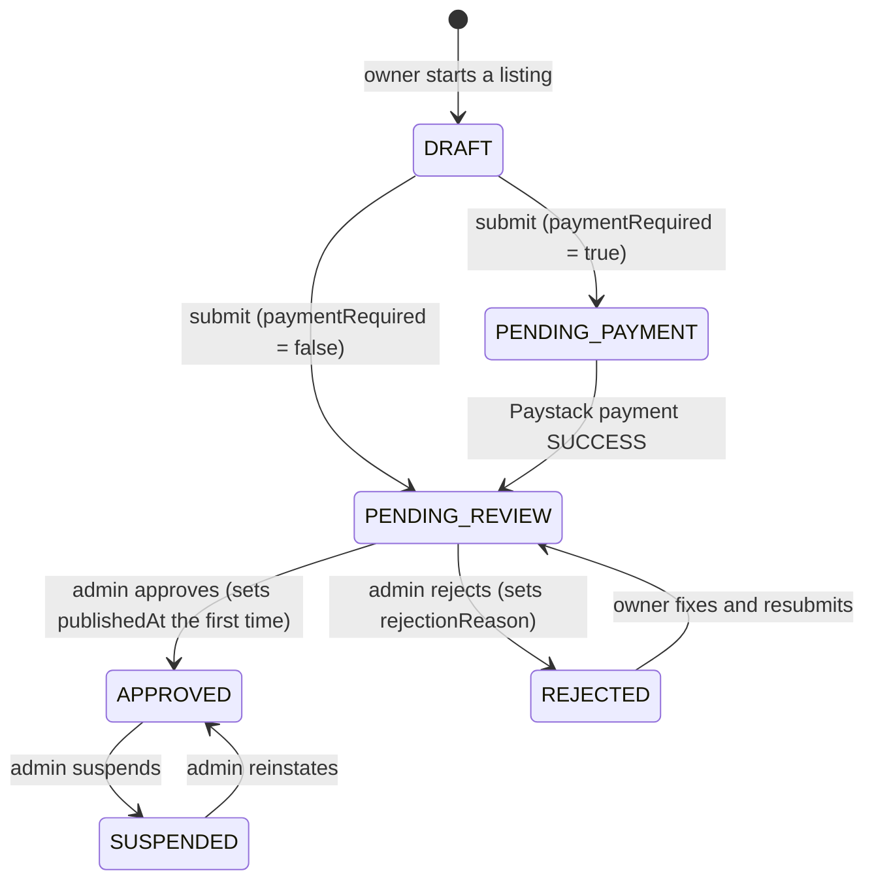

# CustomerHowFar data model

The schema lives in [`prisma/schema.prisma`](../prisma/schema.prisma). PostgreSQL on Supabase,
accessed only through Prisma on the server. Every table has Row Level Security enabled with no
policies, so the public Supabase Data API cannot read or write anything.

## Conventions

- **Tables and columns** are `snake_case` (mapped with `@map`); Prisma models are `PascalCase`.
- **IDs**: UUIDv7 (time-ordered, index-friendly) for user-generated rows; integers for the small
  reference tables (`states`, `lgas`); bigint for high-volume analytics (`contact_events`).
- **Money** is stored in **kobo** as integers (`amountKobo`), never floats. ₦5,000 = 500000.
- **Phone numbers** are stored in E.164 form: `+234XXXXXXXXXX`.
- **Images** are stored as Cloudinary public IDs, never URLs. Build URLs with
  `src/lib/images.ts`.
- **Timestamps**: every mutable table has `created_at` and `updated_at`.
- **Integrity rules the schema language can't express** live as `CHECK` constraints in the
  migration: rating 1–5, positive payment amounts, non-negative counters, etc.

## Models

| Model           | Purpose                                                                                                                                                                                                                                                                                                                 |
| --------------- | ----------------------------------------------------------------------------------------------------------------------------------------------------------------------------------------------------------------------------------------------------------------------------------------------------------------------- |
| `AppSetting`    | Single row (id 1) of global admin settings: `paymentRequired` (listing fee on/off) and `listingFeeNaira`.                                                                                                                                                                                                               |
| `Profile`       | App profile for a Supabase Auth user (same UUID). Name, phone, avatar and `role` (`CUSTOMER`, `BUSINESS_OWNER`, `ADMIN`).                                                                                                                                                                                               |
| `Category`      | Service categories (e.g. Electricians). `slug` is permanent. `icon` is a lucide icon name resolved via `src/config/category-icons.ts`. `parentId` allows subcategories. Deactivate (`isActive = false`) instead of deleting.                                                                                            |
| `State`         | The 36 states plus the FCT (37 rows).                                                                                                                                                                                                                                                                                   |
| `Lga`           | All 774 Local Government Areas, each linked to its state. Slugs are unique _per state_ (Surulere exists in Lagos and Oyo).                                                                                                                                                                                              |
| `Business`      | A listing owned by a `Profile`: name, category, contact details (phone, WhatsApp, email), address, state + LGA, services, opening hours (JSON), social links, logo/cover images, status, verification and featured flags, and denormalized counters (`viewCount`, `contactClickCount`, `ratingAverage`, `reviewCount`). |
| `BusinessPhoto` | Work photos for a business (Cloudinary public ID, dimensions, caption, order). Max 12 per business, enforced in app code.                                                                                                                                                                                               |
| `Payment`       | Listing-fee payments via Paystack: amount in kobo, unique `reference` (makes webhooks idempotent), status, `paidAt`, raw provider `metadata`.                                                                                                                                                                           |
| `Review`        | A customer's rating (1–5) and comment. One per user per business. `HIDDEN` reviews are kept but not shown.                                                                                                                                                                                                              |
| `SavedBusiness` | A user's saved/favourite businesses (composite key: user + business).                                                                                                                                                                                                                                                   |
| `ContactEvent`  | One row per WhatsApp/call/email click, for analytics. `userId` is null for signed-out visitors.                                                                                                                                                                                                                         |

### Key relationships and delete rules

- **Profile → Business**: one owner, many businesses. Deleting a profile deletes their
  businesses, **unless** payments exist (see below).
- **Business → photos, reviews, saved, contact events**: cascade delete with the business.
- **Business → Category / State / LGA**: `RESTRICT`. Categories and locations in use can't be
  deleted; deactivate them instead.
- **Business → LGA uses a composite foreign key `(lga_id, state_id)`**, so the database itself
  guarantees a business's LGA belongs to its state.
- **Payment → Business / Profile**: `RESTRICT`. Financial records are never deleted, so a
  business or profile with payments can't be hard-deleted. Suspend or anonymize instead.
- **ContactEvent → Profile**: `SET NULL`, so analytics survive account deletion.
- **Profile ↔ Supabase `auth.users`**: no database-level foreign key (Prisma manages only the
  `public` schema). Auth is the source of truth; profiles are created on first sign-in.

### Indexes for the main queries

Public listings always filter on `status = APPROVED`, so the business indexes lead with
`status` or pair it with the filter column:

- newest: `(status, created_at DESC)`
- featured: `(status, is_featured)`
- by category: `(category_id, status)`
- by state: `(state_id, status)`
- by LGA: `(lga_id, state_id, status)` (also serves the composite foreign key)
- owner dashboard: `(owner_id)`; admin queue: `(created_at DESC)`

Full-text search will need its own index (Postgres `tsvector`/trigram) when search is built.

## Business status flow

- Only **`APPROVED`** businesses are shown publicly.
- **`DRAFT`** listings are visible only to their owner and can be edited freely.
- Whether payment is required is read from `AppSetting.paymentRequired` **at submit time**.
- A rejected business keeps its data; the owner edits and resubmits. If it has already paid,
  it does not pay again.

## Reference data and seeding

`npm run db:seed` (idempotent, safe to re-run):

- **Categories** come from `src/config/categories.ts`. The first 12 are the homepage's
  "Popular categories". Re-seeding updates names, icons, descriptions and order, but never
  `isActive`.
- **States** come from `src/config/states.ts`; **LGAs** from `prisma/data/nigeria-lgas.ts`
  (1999 Constitution, First Schedule). The seed refuses to run unless there are exactly 37
  states and 774 LGAs with the constitutional count for every state, then re-checks the
  database after writing.
- Nothing is ever deleted by the seed, because businesses may reference these rows.

The app reads categories, states and LGAs from the database through cached functions in
`src/lib/data/catalog.ts` (cached for days/weeks and tagged). After changing reference data,
re-run the seed and redeploy, or call `updateTag()` with the relevant tag from an admin action.
